---
## Front matter
title: "Лабораторная работа №3"
subtitle: "Кибербезопасность предприятия"
author: 
- Бызова Мария Олеговна
- Верниковская Екатерина Андреевна
- Богаткина Алена Александровна
- Сущенко Алина Николаевна
- Калашникова Ольга Сергеевна
- Абдуллахи Бахара
license: "CC BY"
---

# Цель работы

Целью данной лабораторной работы является получение практических навыков по мониторингу, обнаружению и устранению последствий компьютерных атак на элементы информационных систем организации, а также по реагированию на инциденты информационной безопасности.

# Задачи

Для достижения цели необходимо выполнить следующие задачи:

*  Ознакомиться со схемой проведения киберучений в формате Blue Team.
*  Провести анализ событий ИБ, зафиксированных системой обнаружения вторжений.
*  Зарегистрировать карточки инцидентов ИБ.
*  Устранить уязвимости на сервере MS Exchange (ProxyLogon).
*  Устранить уязвимости и последствия атаки на сервере GitLab.
*  Устранить уязвимости и последствия атаки на сервере PostgreSQL.
*  Подтвердить устранение всех выявленных угроз в интерфейсе полигона AMPIRE.

# Выполнение лабораторной работы

## Подготовка к работе и вход в систему

Для начала работы была выполнена авторизация на рабочей станции администратора. В окне входа в систему ввели учетные данные администратора домена `ampire\it8` ([рис. @fig-001]).

{#fig-001 width=70%}

После успешного входа в систему для доступа к настройкам веб-сервера MS Exchange открыли утилиту «Выполнить» (комбинация клавиш `Win+R`) и ввели команду `inetmgr` для запуска диспетчера Internet Information Services (IIS) ([рис. @fig-002]).

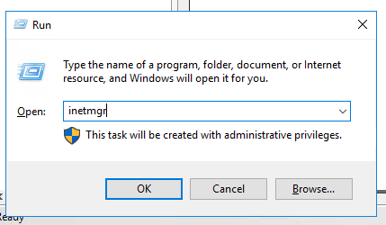{#fig-002 width=70%}

## Атака на почтовый сервер (MS Exchange)

### Устранение уязвимости ProxyLogon (CVE-2021-26855)

В открывшемся диспетчере IIS в дереве подключений развернули узел `MAIL` → `Sites` → `Default Web Site` → `ecp`. В центральной панели выбрали иконку **IP Address and Domain Restrictions** (Ограничения по IP-адресам и доменам) ([рис. @fig-003]).

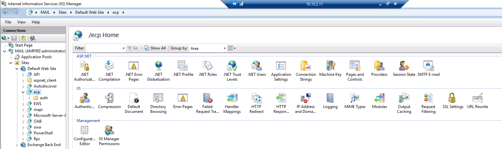{#fig-003 width=70%}

В правой панели «Actions» нажали **Edit Feature Setting** (Изменить параметры функции). В открывшемся окне в выпадающем списке **Access for unspecified clients** выбрали значение **Deny** (Запретить) и нажали **OK** ([рис. @fig-004]).

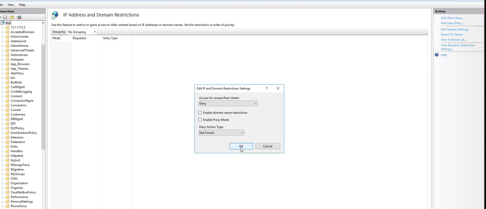{#fig-004 width=70%}

Таким образом, был закрыт доступ к панели управления Exchange (ECP), что предотвращает эксплуатацию уязвимости ProxyLogon.

### Завершение вредоносных соединений и удаление пользователя

На сервере MS Exchange открыли командную строку от имени администратора. С помощью команды `netstat -bo | findstr 10.10.4.55` обнаружили активные соединения с IP-адресом нарушителя. В выводе команды были идентифицированы процессы с PID `16244`, удерживающие соединение на порту `5556`. Для завершения этих процессов выполнили команду `taskkill /PID 16244 /F`. Команда была выполнена дважды для обоих соединений, в результате чего был получен ответ `SUCCESS: The process with PID 16244 has been terminated.` ([рис. @fig-005]).

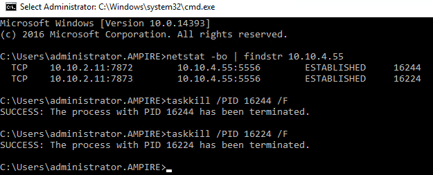{#fig-005 width=70%}

Для удаления учетной записи `hacker`, созданной злоумышленником, открыли оснастку «Local Users and Groups» с помощью команды `lusrmgr.msc`. В списке пользователей обнаружили запись `hacker`, которую необходимо было удалить ([рис. @fig-006]).

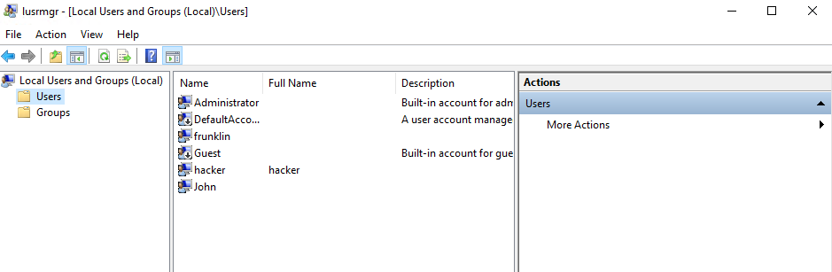{#fig-006 width=70%}

В командной строке выполнили команду `net user hacker /delete`. Получили сообщение `The command completed successfully.`, что подтвердило успешное удаление пользователя ([рис. @fig-007]).

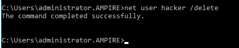{#fig-007 width=70%}

## Атака на GitLab

### Анализ состояния GitLab и восстановление данных

Для оценки последствий атаки на сервер GitLab открыли веб-интерфейс по адресу `http://10.10.2.18/gitlab/`. На главной странице в разделе **Projects** отображается список проектов, среди которых есть `Administrator / Very sensitive project` ([рис. @fig-008]).

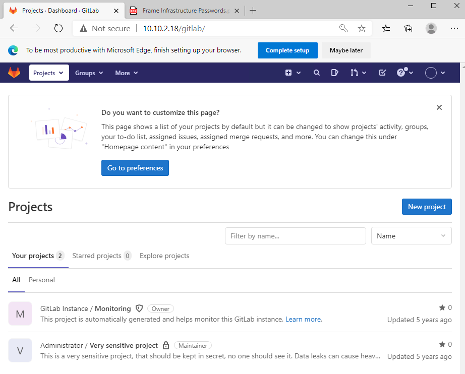{#fig-008 width=70%}

Перешли в проект `Very sensitive project`. В интерфейсе отображается сообщение **«The repository for this project is empty»** (Репозиторий этого проекта пуст). Это подтверждает, что злоумышленник удалил все файлы и коммиты ([рис. @fig-009]).

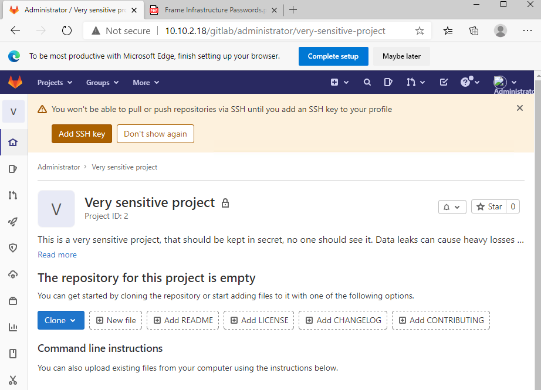{#fig-009 width=70%}

Для восстановления данных подключились к серверу GitLab. В терминале выполнили команду `sudo -i` для получения прав суперпользователя (`root`). Перешли в каталог с резервными копиями командой `cd /var/opt/gitlab/backups/` и проверили содержимое командой `ls`. В каталоге обнаружен файл `stable_gitlab_backup.tar`. Остановили сервисы GitLab командами `gitlab-ctl stop puma && gitlab-ctl stop sidekiq`. Успешная остановка подтверждается сообщениями `ok: down: puma: 0s` и `ok: down: sidekiq: 0s` ([рис. @fig-010]).

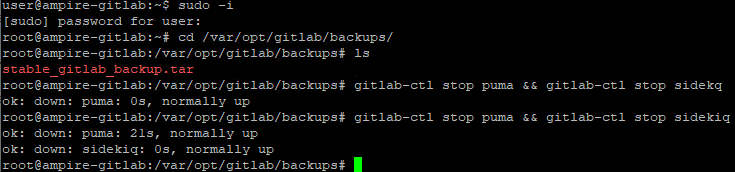{#fig-010 width=70%}

Запустили восстановление из резервной копии командой `gitlab-backup restore BACKUP=stable` ([рис. @fig-011]).

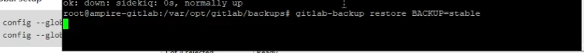{#fig-011 width=70%}

После завершения восстановления появилось сообщение `Restore task is done.` с предупреждением о том, что файлы `gitlab.rb` и `gitlab-secrets.json` содержат конфиденциальные данные и не включены в резервную копию. Далее выполнили переконфигурацию и перезапуск GitLab командами `gitlab-ctl reconfigure && gitlab-ctl restart` ([рис. @fig-012]).

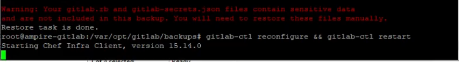{#fig-012 width=70%}

После перезапуска обновили страницу проекта в веб-интерфейсе. В репозитории `very-sensitive-project` появились файлы `README.md` и `main.py`, а также история коммитов, что свидетельствует об успешном восстановлении данных ([рис. @fig-013]).

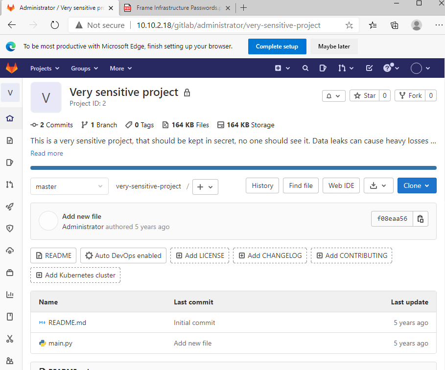{#fig-013 width=70%}

### Обновление версии GitLab для закрытия уязвимости

Для закрытия уязвимости CVE-2021-22204/22205 необходимо обновить GitLab до версии 13.10.3. На рабочей станции администратора (Windows) открыли сетевую папку `\\10.140.2.30\updates\AMpire_Frame_Enterprise\Gitlab\` и обнаружили установочный пакет `gitlab-ce_13.10.3-ce.0_amd64.deb` ([рис. @fig-014]).

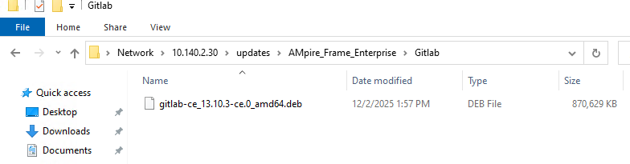{#fig-014 width=70%}

В командной строке PowerShell выполнили команду `scp .\gitlab-ce_13.10.3-ce.0_amd64.deb user@10.10.2.18:/home/user/`. При первом подключении подтвердили ключ хоста (введя `yes`), после чего ввели пароль. Файл был успешно скопирован (100% 850MB, скорость 84.1MB/s) ([рис. @fig-015]).

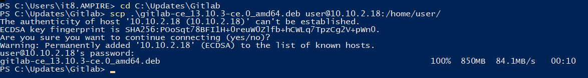{#fig-015 width=70%}

На сервере GitLab проверили наличие файла в каталоге `/home/user/` командой `ls -la`. Убедились, что файл `gitlab-ce_13.10.3-ce.0_amd64.deb` присутствует ([рис. @fig-016]).

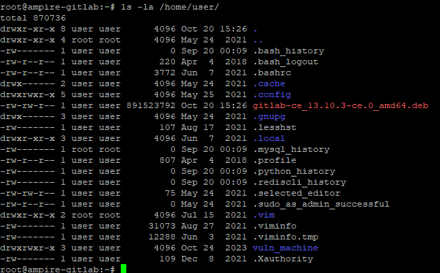{#fig-016 width=70%}

Выполнили установку пакета командой `dpkg -i gitlab-ce_13.10.3-ce.0_amd64.deb`. В процессе установки система сообщила о замене пакета `gitlab-ee` на `gitlab-ce` и начала распаковку ([рис. @fig-017]).

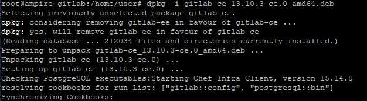{#fig-017 width=70%}

По завершении установки появилось сообщение `Upgrade complete!` с рекомендацией перезапустить сервисы командой `sudo gitlab-ctl restart` ([рис. @fig-018]).

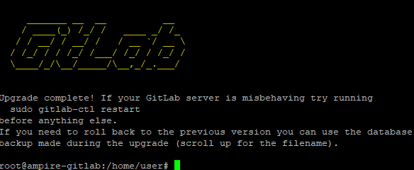{#fig-018 width=70%}

### Устранение активной сессии нарушителя

После обновления проверили активные сетевые соединения. С помощью команды `ss -tp | grep 10.10.4.55` обнаружили установленное соединение (`ESTAB`) с IP-адресом `10.10.4.55` на порту `5557`, которое удерживалось процессом `Fk2Xc3` с PID `3154`. Завершили этот процесс командой `kill -9 3154`. Повторная проверка показала отсутствие соединений с данным IP ([рис. @fig-019]).

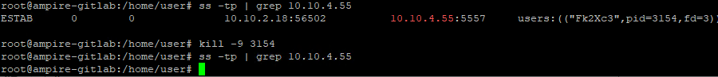{#fig-019 width=70%}

## Атака на сервер PostgreSQL

### Устранение уязвимости конфигурации и завершение сессий

Для закрытия уязвимости CVE-2019-9193 подключились к серверу PostgreSQL. Отредактировали конфигурационный файл `postgresql.conf`, изменив параметр `listen_addresses` на `'localhost'` ([рис. @fig-020]).

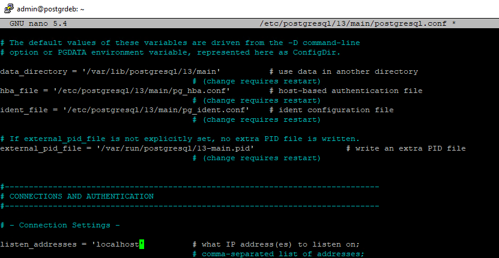{#fig-020 width=70%}

Затем отредактировали файл `pg_hba.conf`, заменив разрешающую правило `host all all all password` на более строгое `host all all 10.10.2.0/24 scram-sha-256` ([рис. @fig-021]).

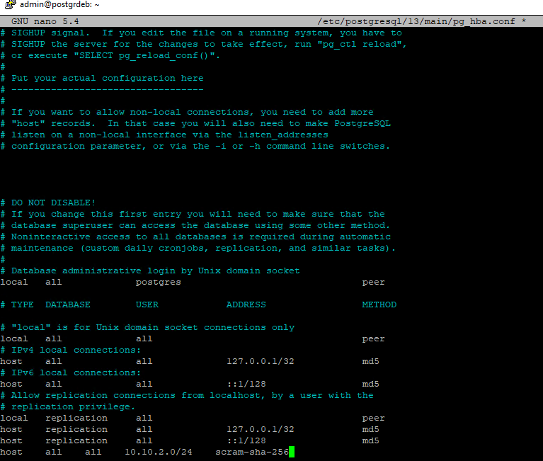{#fig-021 width=70%}

Сменили скомпрометированный пароль пользователя `postgres` с помощью команды `\password` в консоли `psql` ([рис. @fig-022]).

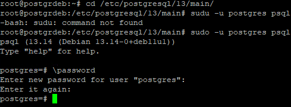{#fig-022 width=70%}

С помощью команды `ss -tp4` обнаружили активные сессии нарушителя (процессы с PID 1946, 1910, 1909), удерживающие соединения с IP `10.10.4.55`. Завершили их командами `kill -9 1946`, `kill -9 1910`. ([рис. @fig-024]).

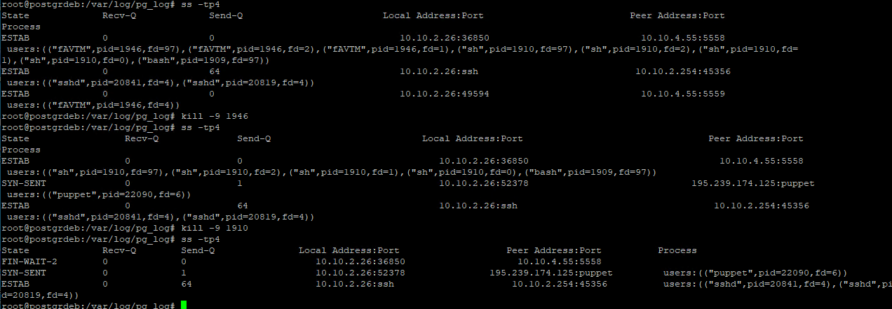{#fig-023 width=70%}

### Расшифровка файлов, зашифрованных злоумышленником

Для восстановления данных проанализировали логи PostgreSQL. С помощью команды `grep 'postgres@demo' postgresql-2026-10-20_124940.log` нашли запись о создании таблицы `hacker_table` и выполнении команды `COPY ... FROM PROGRAM` с закодированной в base64 полезной нагрузкой ([рис. @fig-024] - [рис. @fig-025]).

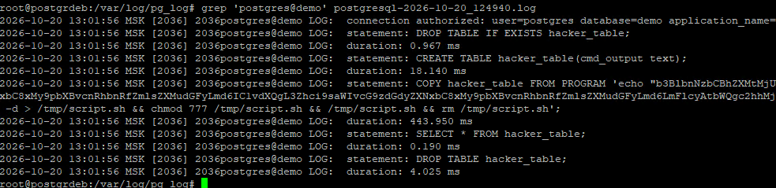{#fig-024 width=70%}

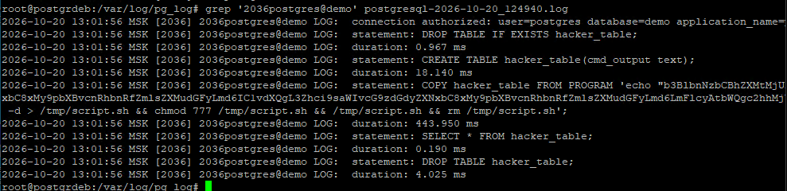{#fig-025 width=70%}

Скопировали base64-строку из лога и декодировали её командой `echo "..." | base64 -d`. ([рис. @fig-026]).

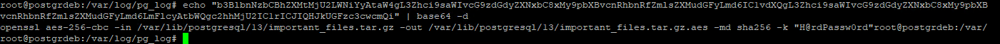{#fig-026 width=70%}

Выполнили расшифровку файла командой `openssl aes-256-cbc -in important_files.tar.gz.aes -out important_files.tar.gz -d`, введя найденный пароль.  Файл был успешно расшифрован ([рис. @fig-027]).

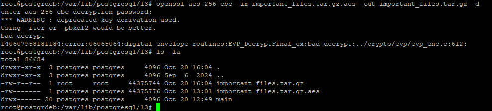{#fig-027 width=70%}

Распаковали полученный архив командой `tar xvf important_files.tar.gz -C /var/lib/postgresql/13/important_files/`. В каталоге появились восстановленные файлы `passwords`, `snapshot1`, `snapshot2`, `winrar.key` ([рис. @fig-028]).

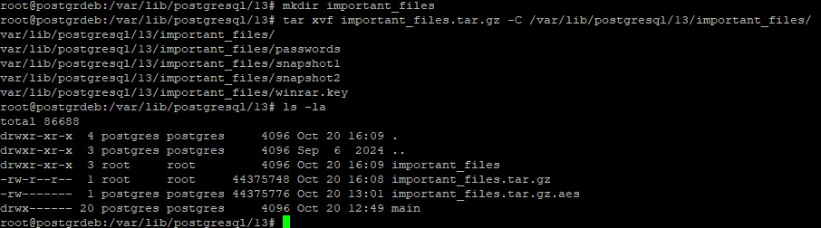{#fig-028 width=70%}

После этого в разделе «Уязвимости и последствия» все задачи были переведены в статус **«Устранено»** ([рис. @fig-029]).

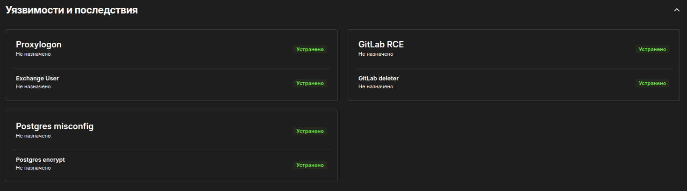{#fig-029 width=70%}

## Регистрация инцидентов в системе AMPIRE

В разделе «Инциденты» созданы карточки для всех атак ([рис. @fig-030]).

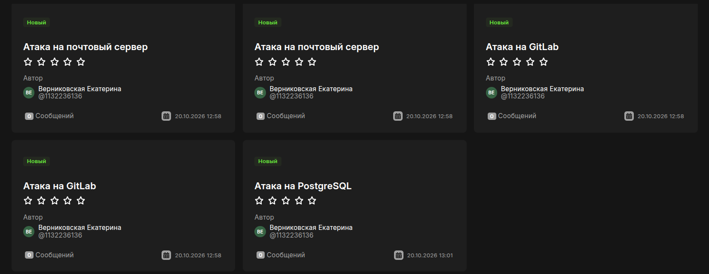{#fig-030 width=70%}

### События в ViPNet IDS NS

**Атака на почтовый сервер.** В событиях зафиксирована активность Metasploit и PowerShell с IP `10.10.4.55` на `10.10.2.11` ([рис. @fig-031]).

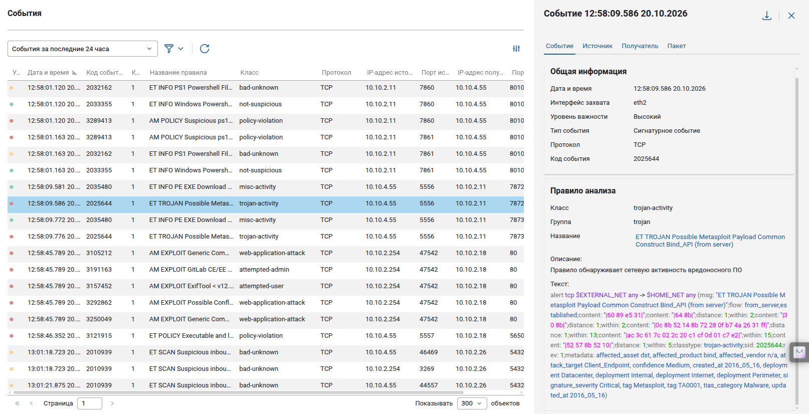{#fig-031 width=70%}

**Атака на GitLab.** Обнаружены события `AM EXPLOIT GitLab`, `ExifTool` и загрузка ELF-файла с IP `10.10.4.55` на `10.10.2.18` ([рис. @fig-032]).

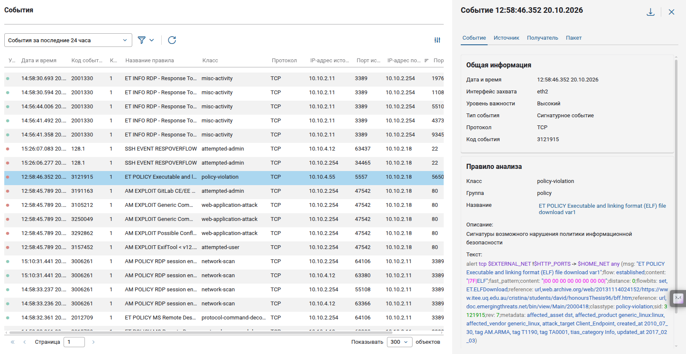{#fig-032 width=70%}

**Атака на PostgreSQL.** Зафиксированы события `ET SCAN` и `AM EXPLOIT PostgreSQL RCE via COPY FROM PROGRAM` с IP `10.10.4.55` на `10.10.2.26` ([рис. @fig-033]).

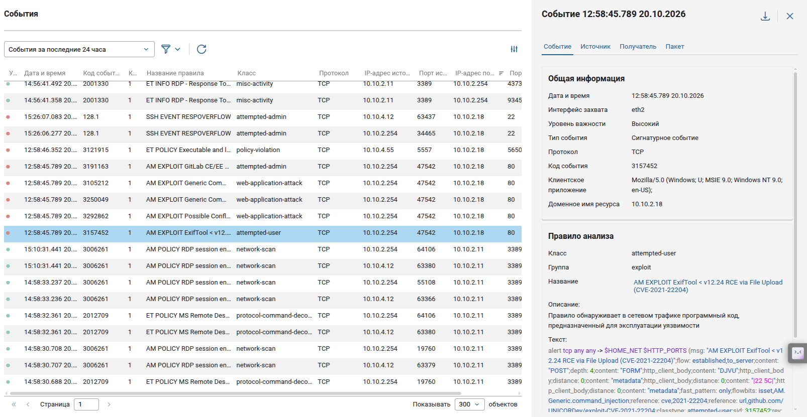{#fig-033 width=70%}

**Повторная попытка эксплуатации ExifTool на GitLab.** Обнаружено событие `AM EXPLOIT ExifTool < v12.24 RCE via File Upload` с IP `10.10.4.55` ([рис. @fig-034]).

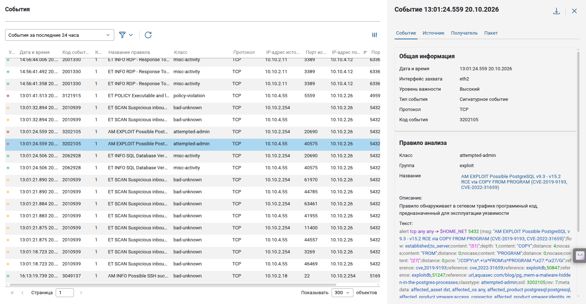{#fig-034 width=70%}

### Заполнение карточек инцидентов

В первой карточке для почтового сервера указали: источник — `10.10.4.55`, актив — `10.10.2.11 (MS Exchange)`, описание — активность Metasploit, рекомендации — проверить соединения и файлы ([рис. @fig-035]).

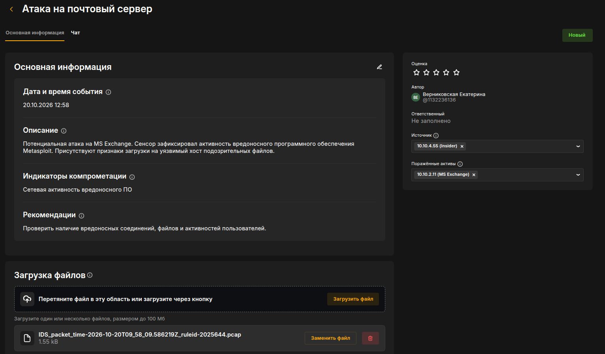{#fig-035 width=70%}

Во второй карточке описали ProxyLogon (CVE-2020-26855 + CVE-2021-27065), рекомендации — закрыть ECP и установить патч KB5000871 ([рис. @fig-036]).

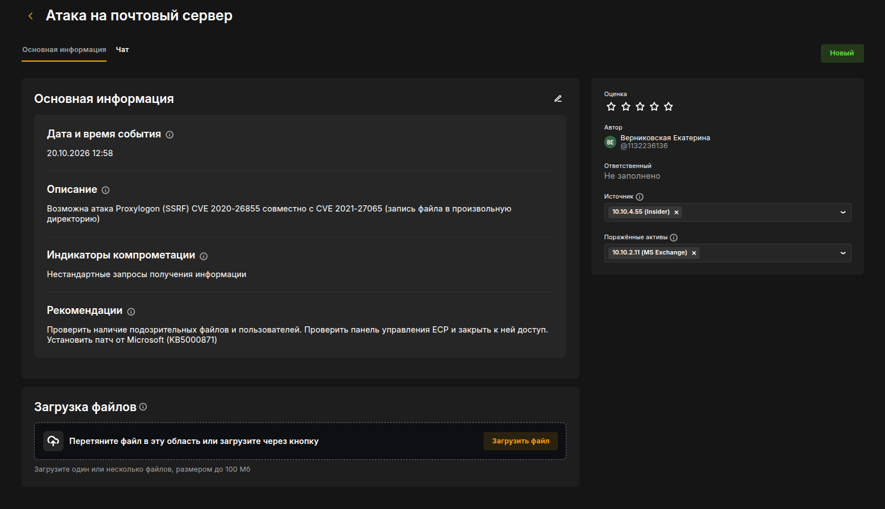{#fig-036 width=70%}

В первой карточке для GitLab указали: источник — `10.10.4.55`, актив — `10.10.2.18 (GitLab)`, описание — POST-запрос на регистрацию, рекомендации — инспекция сервера ([рис. @fig-037]).

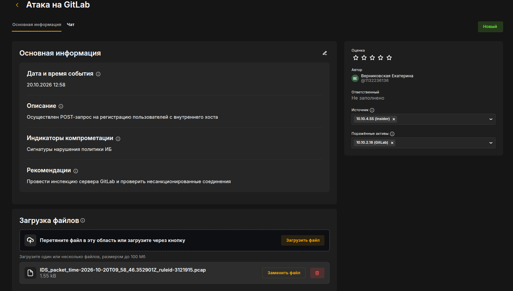{#fig-037 width=70%}

Во второй карточке GitLab описали загрузку вредоносного файла (CVE-2021-22204), рекомендации — обновить версию и запретить создание аккаунтов ([рис. @fig-038]).

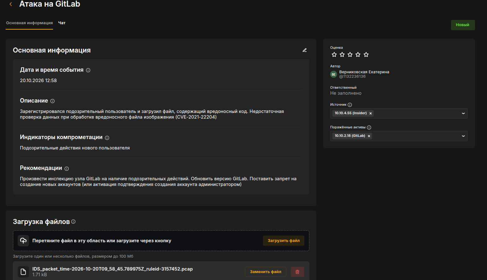{#fig-038 width=70%}

В карточке для PostgreSQL указали: источник — `10.10.4.55`, актив — `10.10.2.26 (Postgres)`, описание — эксплуатация CVE-2019-9193 через COPY FROM PROGRAM, рекомендации — изменить политику удаленного подключения ([рис. @fig-039]).

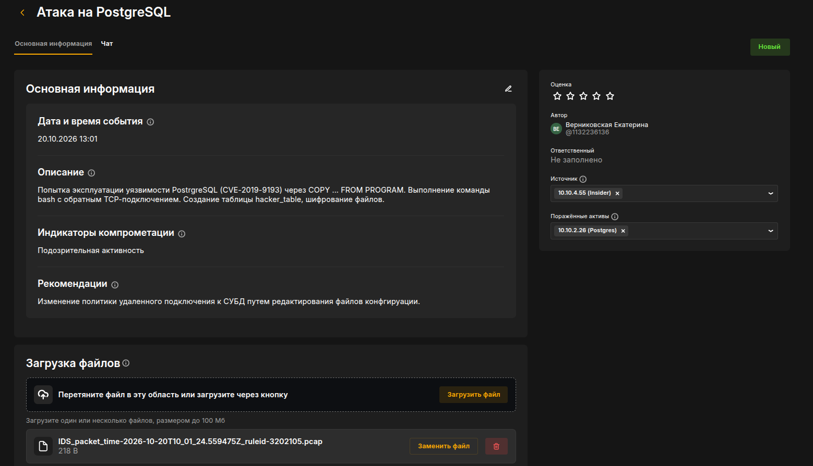{#fig-039 width=70%}

# Вывод

В ходе выполнения лабораторной работы были получены практические навыки по реагированию на инциденты информационной безопасности в формате Blue Team. Были успешно устранены уязвимости на трех серверах: MS Exchange (ProxyLogon), GitLab (RCE) и PostgreSQL (CVE-2019-9193). Выполнены действия по завершению активных сессий злоумышленника, удалению нелегитимных учетных записей, восстановлению поврежденных данных и изменению конфигураций для предотвращения повторных атак. Все инциденты были зарегистрированы в системе AMPIRE с указанием источника атаки, пораженных активов, индикаторов компрометации и рекомендаций по устранению. В результате все задачи были переведены в статус «Устранено», что подтверждает достижение цели работы.

# Список литературы {.unnumbered}

::: {#refs}
:::
